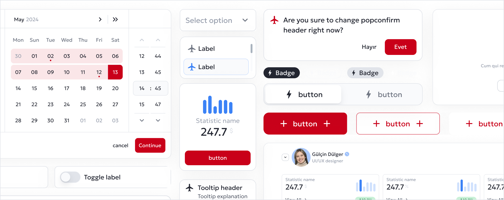

# Spar

> [!IMPORTANT]
> **This repository is archived.** Spar is now developed and released from
> [turkishtechnology/takeoff-v2](https://github.com/turkishtechnology/takeoff-v2/tree/develop/packages/spar),
> in `packages/spar`, with this repository's history. The npm package is still
> `@turkish-technology/spar`. Version 0.3.2 and every later version are
> published from takeoff-v2.
>
> - Open new issues and pull requests in takeoff-v2.
> - Existing issues, pull requests and branches stay here, read-only, for
>   reference.
> - The `docs`, `next-app`, `react-app` and `mcp-server` apps were not moved.

An open-source Headless React UI library delivering unstyled, behavior-first primitives.
Zero styling opinions, full accessibility built-in.



[](https://www.npmjs.com/package/@turkish-technology/spar)
[](https://www.npmjs.com/package/@turkish-technology/spar)
[](https://github.com/turkishtechnology/spar/blob/develop/LICENSE)

## Installation

```bash
pnpm add @turkish-technology/spar
# or
yarn add @turkish-technology/spar
# or
npm install @turkish-technology/spar
# or
bun add @turkish-technology/spar
```

## Documentation

For full documentation, visit [Documentation Guide](https://spar.app.turkishtechlab.com/).

## Contributing

Contributions now go to [takeoff-v2](https://github.com/turkishtechnology/takeoff-v2); see its [CONTRIBUTING.md](https://github.com/turkishtechnology/takeoff-v2/blob/develop/CONTRIBUTING.md).

## License

See [LICENSE](./LICENSE) for details.
